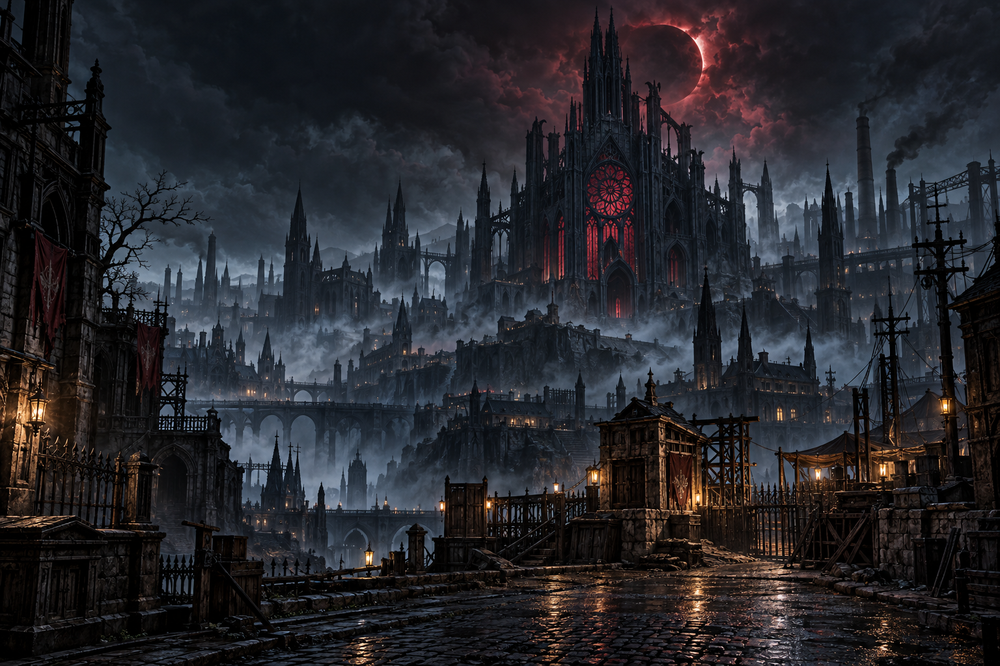

# BLOODFALL · Nocturne 아트 방향

최근 적용: Nocturne 환경 개선 / 2026-10-31 (한국 시간).

## 2026-10-31 · 조사 범위와 실제 적용

공식 다크에덴 사이트·검색 사이트·외부 게임 스크린샷 호스트는 현재 실행 환경의 네트워크 정책에서 차단되었습니다. 공개 GitHub 검색과 문서 조회는 가능했습니다. 따라서 **최신 공식 게임 스크린샷을 웹에서 확보해 분석했다고 주장하지 않습니다**.

실제로 열어 확인한 웹 자료:

- [다크에덴 관련 클라이언트 문서](https://github.com/vicstoppapt/dk2web/tree/main/client): 스크린샷 링크를 찾았지만 연결된 이미지 호스트는 차단되어 해당 스크린샷 자체를 보지 못했습니다.
- [커뮤니티 사이트의 로그인 패널 이미지](https://github.com/vicstoppapt/dk2web/blob/main/darkedenweb2/images/headaa1.png): 해진 종이, 산화된 철 테두리, 낮은 채도 얼굴과 작은 밝은 눈의 대비를 확인했습니다. 출처는 제3자 저장소이며 공식 배포물로 인증하지 않습니다.
- 같은 저장소의 `slayer.png`, `vampire.png`는 실제 캐릭터가 아니라 진영 글자 이미지였습니다. 인게임 캐릭터 참고 자료로 취급하지 않았습니다.
- 이전 대화에서 사용자가 첨부한 다크에덴 게임 화면은 직접 확인했습니다. 이 화면의 작은 포석, 군용 철조망·천막·보급품, 동일 시점의 캐릭터·배경, 어두운 배경 속 밝은 상호작용 지점을 분석 기준으로 삼았습니다.

분석 자료를 재배포하거나 게임 자산으로 사용하지 않았습니다. 직접 확인한 자료와 접근 실패를 구분하며, 아래 아트는 독자적인 생성물입니다.

### 구현

- 기존 도형 위주의 마을 구조물을 질감이 있는 원본 PNG 아트로 교체: 인간 본부·벙커·천막·통신소·트럭·보급품, 혈족 성채·납골당·첨탑·동굴·분수·성벽.
- 낡은 가게, 폐차, 덮인 유해, 광석, 고목, 침엽수, 묘지, 가로등으로 외부 파밍 지점을 구분. 새 파밍 규칙을 추가한 것은 아닙니다.
- 마을/필드/던전 바닥에 포석·흙·아스팔트·석판 재질을 적용하고 중앙 대로·광장·가로등을 구성. 이동 좌표와 서버 충돌/규칙은 유지합니다.
- 사냥개형과 갑옷 망령형에 각 16프레임의 새 이동 시트를 적용. 전체 몬스터 유형마다 고유 시트를 만든 것은 아니며, 기존 감염자·거체 시트와 함께 유형별로 공유합니다. 플레이어 이동 시트와 입력 처리는 유지합니다.
- 원본 이미지를 매 프레임 축소하지 않고 프레임별 캐시로 재사용. 지형은 화면 주변 청크만 유지하며 새 텍스처가 로드되면 캐시를 갱신합니다. 이미지 로드 실패 시 기존 도형/스프라이트 폴백을 사용합니다.

`tests/nocturne_browser.cjs`에서 인간 마을·혈족 마을·야외·개인 영지·모바일의 실제 캔버스를 검사합니다. 테스트 스크린샷은 `/tmp/nocturne-*.png`에 생성하며 GitHub Actions 아티팩트에 보관합니다. 프레임 시간은 테스트 장비의 참고 측정값이며 모든 사용자 기기의 FPS 보장은 아닙니다.

## 이전 아트 방향과 해석

사용자가 요청한 한국 PC 게임 **다크에덴**을 분위기 참고 대상으로 삼았습니다. 현대 도시와 고딕 호러의 결합, 인간과 뱀파이어의 대비, 낡은 금속·어두운 석조 건축이라는 넓은 시각 요소를 BLOODFALL용으로 새롭게 구성합니다. 원작 캐릭터·맵·로고·UI 이미지·스프라이트를 가져오거나 재현하지 않습니다.

공식 사이트 `https://www.darkeden.com/` 접근은 작업 환경의 프록시에서 403으로 차단되었습니다. 따라서 최신 공식 스크린샷을 직접 열어 비교한 리서치라고 주장하지 않습니다. 이 아트 방향은 요청한 PC 고딕 호러 분위기를 해석한 독자적인 디자인입니다.

## 색과 재질

| 역할 | 기준 색 | 화면에서의 용도 |
| --- | --- | --- |
| 밤의 바탕 | `#0d1018` | 창·화면 바탕, 석조 건물 그림자 |
| 냉회색 | `#404449` | 도시 포장과 석재 |
| 피와 연금 | `#9c5266` | 뱀파이어·선택 상태·체력 강조 |
| 낡은 황동 | `#c4ac82` | 구조물 윤곽·제목·등불 |
| 빛바랜 상아 | `#e6e0d4` | 본문과 중요한 조작 정보 |

짙은 밤색으로 분위기를 만들되, 자원 이름·체력바·현재 위치·조작 버튼은 읽을 수 있게 남깁니다. 세계 지형과 접근 가능한 자원의 위치는 기존 데이터를 유지합니다.

## 신규 일러스트

이미지 생성 도구로 이 프로젝트를 위해 새로 생성한 PNG 3장입니다. 입력 레퍼런스 이미지 없이 텍스트 설명으로 제작했습니다. 출처와 해시는 [자산 목록](../ASSETS.md)에 기록합니다.

### 밤의 도시

폐성당, 공업 도시의 굴뚝, 습한 포석, 붉은 일식과 희미한 등불. 제목 화면의 공간적 배경과 아지트 메뉴 삽화로 사용합니다. 특정 던전이나 성당 입장 기능을 의미하지 않습니다.

### 인간 · 빛을 지키는 자

낡은 코트, 실용적인 장비, 차가운 달빛 속 따뜻한 등불. 인간 진영의 종족 선택과 생존자 초상에 사용합니다. 이름 있는 원작 인물을 묘사하지 않습니다.

[인간 초상 원본](../public/art/human-warden.png)

### 뱀파이어 · 밤을 걷는 자

높은 옷깃, 은 장식, 와인색 안감, 절제된 붉은 눈과 연금 혈액병. 뱀파이어 진영의 종족 선택과 생존자 초상에 사용합니다.

[뱀파이어 초상 원본](../public/art/vampire-scholar.png)

## 게임 안의 아트

- `public/art/gameplay/`: 피난처·폐허·소나무·고사목, 인간/뱀파이어·마른/육중한 감염체, 생활 오브젝트 시트, 석재·흙 텍스처 등 신규 PNG 11장.
- `public/sprite-manifest.js`: 원본 픽셀 기준으로 검토한 오브젝트/프레임 영역. 파일을 자르지 않고 Canvas에서 해당 영역을 샘플링합니다.
- `public/sprites.js`: 발 위치를 기준으로 스프라이트를 배치하고 이동 방향과 보행/정지를 표시합니다. 인간·마른 감염체의 중복된 후면 방향은 좌우 반전합니다. 정적 지형은 쿼터뷰로 한 번 투영해 화면 안 영역만 복사하고, 큰 스프라이트는 크기가 제한된 런타임 캐시를 재사용합니다. 배경·안개·비네트도 캐시하며 안개 위치는 고정합니다.
- `public/world.js`: 카메라·깊이 정렬·클릭 범위·플레이어 가림 완화·장식 밀도를 통합합니다. 나무·건물은 충돌하지 않습니다.
- `public/gothic.js`: 로딩/오류 시 대체 도형, 탑승 형태, 안개·빛 효과를 유지합니다.

보행은 4방향×4프레임이며 전용 공격·피격·사망 애니메이션은 없습니다. 감염체 두 외형의 능력치는 동일하며 신규 전투 유형을 의미하지 않습니다. 실내·충돌·던전·8방향 애니메이션은 후속 작업입니다.

## 제작·유지 지침

이미지 원본은 `public/art/`에 보관하며 별도 CDN을 사용하지 않습니다. PNG는 재인코딩하거나 자르지 않았고 메뉴에서는 CSS로 배치하고 필드에서는 Canvas 소스 영역·크기·반전으로 렌더링합니다. 나무와 폐허의 투명 배경 보정도 동일 이미지 생성 도구로 수행했습니다. 추후 교체 시 ASSETS.md에 제작 방식·출처·수정 내역을 갱신합니다. 공개 라이선스를 새로 부여하지 않습니다.

## 2026-10-31 · 파밍 환경의 다양성

공식 다크에덴 커뮤니티 및 Google 이미지 검색을 다시 시도했으나 실행 환경 프록시의 403으로 접근하지 못했습니다. 새 웹 이미지를 분석한 것으로 기록하지 않습니다. 사용자가 앞서 제공한 다크에덴 스크린샷의 군용 보급·폐허·고딕 분위기를 방향으로 삼아, 나무/건물 반복을 줄이고 낮은 보급품·기계·수레·묘역과 탐사 입구를 신규 원본으로 제작했습니다. 신규 20종은 각각 별도 프레임이며 모두 서버 파밍 테이블과 연결됩니다. 동굴은 현 단계에서 입구 수색 지점이며 기존 인스턴스 던전과 구분합니다.

## 2026-10-31 · 군용 차량과 혈익 이동수단

인간은 검은 군용 오토바이·장갑 다목적 차량, 혈족은 붉은 가죽 날개의 박쥐·황금 고딕 장식의 거대 박쥐로 대비했습니다. 기존 대화에서 제공된 다크에덴 화면과 군용/고딕 미술 방향을 참고한 신규 원본이며, 새 웹 자료를 확보한 것으로 주장하지 않습니다. 실시간 3D 모델이 아니라 4방향 래스터와 미세한 진동/부유/날갯짓 변형입니다. 시설은 기존 건물 아트와 해당 이동수단을 조합해 구분합니다.

## 2026-10-31 · 스킬의 준비와 타격 구분

12종 신규 VFX 원화를 투사체 궤적·확장 충격파·입자·피격 반응과 조합했습니다. 전용 공격 애니메이션 시트를 새로 만든 것은 아니며, 기존 캐릭터 방향 프레임과 준비/반동/복귀 변위를 조합합니다. 인게임 판정과 이동을 멈추는 히트 스톱 대신 공격 포즈에 짧은 타격 순간을 강조합니다. 화면 전체 백색 섬광은 사용하지 않습니다.
